# ForgeGPT

**A GPT written from scratch, trained on 1.6 million vehicle complaints, and made 11× faster
for CPU inference, with every step measured.**

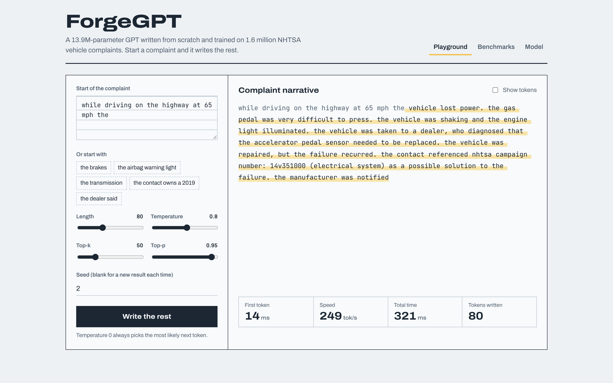

ForgeGPT is a decoder-only transformer (the GPT-2 architecture) implemented in plain PyTorch:
attention, blocks, embeddings and the training loop are all in this repo, with no
`nn.Transformer`. It is trained on the narratives of the public NHTSA vehicle-complaints
database, optimized for CPU inference (KV cache, ONNX Runtime, INT8), served through a
streaming API and web GUI, and benchmarked for quality, latency, throughput and memory.

> **What was run.** The 13.9M-parameter model was trained on a free Kaggle Tesla T4
> (163.8M tokens, 44 minutes), with five ablation runs. All CPU benchmarks ran on a 2-vCPU
> Linux machine. The repo is also **Lambda-ready**: the AWS Lambda package and AWS CDK stack
> in `infra/` are built and tested locally, but not deployed (see
> [docs/DEPLOY.md](docs/DEPLOY.md)). Numbers marked *projected* are computed from local
> measurements; everything else is measured.

## Architecture

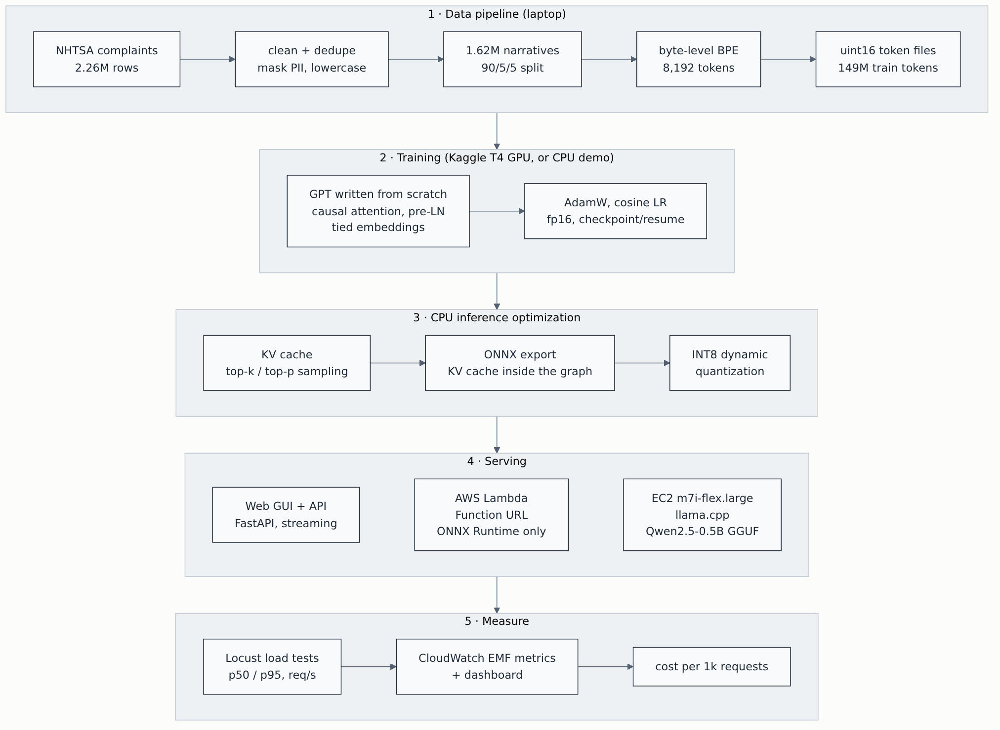

| Stage | What | Where |
|---|---|---|
| Data | Download, clean (11 rules), dedupe, split 2.26M rows → 1.62M narratives | `scripts/download_nhtsa.py`, `src/forgegpt/clean.py` |
| Tokenizer | Byte-level BPE, 8,192 tokens, trained on the train split | `src/forgegpt/tokenizer.py` |
| Model | Causal multi-head attention, pre-LN blocks, GELU MLP, tied embeddings, KV cache | `src/forgegpt/model.py` |
| Training | AdamW, warmup + cosine, grad clipping, fp16 + grad scaler, checkpoint/resume, ablations | `src/forgegpt/train.py`, `notebooks/kaggle_train.ipynb` |
| Inference | Greedy / temperature / top-k / top-p, KV-cached streaming generation | `src/forgegpt/generate.py` |
| Optimization | ONNX export with the KV cache inside the graph, dynamic INT8 quantization | `src/forgegpt/onnx_export.py` |
| Serving | FastAPI + web GUI with token streaming; Lambda handler (ONNX Runtime + numpy only) | `serving/` |
| Deployment (ready, not deployed) | AWS CDK: S3, Lambda + Function URL, optional EC2 llama.cpp baseline, dashboard | `infra/`, `serving/ec2/` |
| Quality | 55 unit and integration tests, ruff, GitHub Actions CI | `tests/`, `.github/` |

## Results

### Data and tokenizer

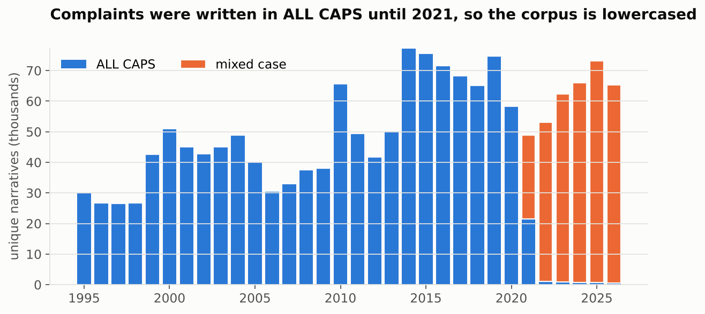

Complaints filed before 2021 are almost entirely upper case and later ones are not, so
the corpus is lowercased; otherwise the model would learn two "dialects" and the
tokenizer would spend vocabulary on `BRAKE` and `brake`. Cleaning also removes NHTSA
analyst tags and legal boilerplate and masks phone numbers, emails, URLs and VINs
(details and counts in [docs/DATA.md](docs/DATA.md)).

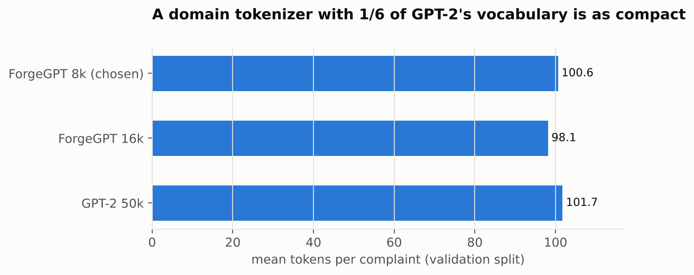

A custom 8k byte-level BPE encodes complaints in 100.6 tokens on average versus 101.7 for
GPT-2's 50k vocabulary. At width 384 that is a 3.1M-parameter embedding table instead of
19.3M, which matters in a model this size, and a 6× smaller output layer on CPU.

### Training

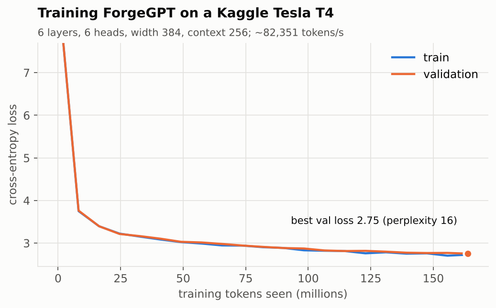

The model (6 layers, 6 heads, width 384, context 256; 13.9M parameters) trained for 10,000
steps of 64 × 256 tokens: 163.8M tokens, about 1.1 epochs of the training split, in
**44 minutes on a Kaggle Tesla T4** in fp16 at ~82,000 tokens/s. Validation loss fell from
9.04 (perplexity 8,461: a uniform guess over the 8,192-token vocabulary) to **2.753, a
perplexity of 15.7**. Train and validation loss stay together (2.729 vs 2.753 at the end),
so there is no overfitting at this budget. For comparison, a 5.3M-parameter model trained on
CPU for 96 minutes (`configs/cpu_demo.json`) reached 29.8.

Full logs, configs and per-evaluation samples: [`benchmarks/results/training/`](benchmarks/results/training/).

Samples from the final model (prompt in bold; INT8 ONNX, temperature 0.8, top-k 50, top-p 0.95):

> **while driving on the highway at 65 mph the** vehicle lost power. the gas pedal was very
> difficult to press. the vehicle was shaking and the engine light illuminated. the vehicle was
> taken to a dealer, who diagnosed that the accelerator pedal sensor needed to be replaced. the
> vehicle was repaired, but the failure recurred.
>
> **the contact owns a 2019** honda hr-v. the contact stated that the rear seat belt latch would
> not function properly. the contact stated that he attempted to release the seat belt but the
> latch failed to operate. the vehicle was taken to the dealer and the dealer repaired the vehicle.
>
> **the airbag warning light** is on and the passenger airbag is not working. i have been told
> that it may be the passenger seat sensor which has been recalled on other model vehicles. my
> car has been at the dealership since march 2023 and they were unable to find a problem.

It writes in both registers of the data: first-person owner complaints and NHTSA's own
"the contact stated…" summaries. Like any language model it also invents plausible details,
such as recall campaign numbers (*"nhtsa campaign number: 14v351000"*) and model names.

#### Ablations

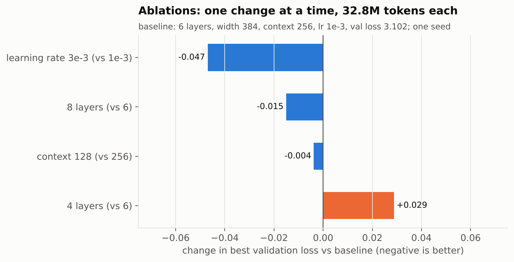

| Run (2,000 steps, 32.8M tokens each) | Parameters | Best val loss | Val perplexity | Train time |
|---|---:|---:|---:|---:|
| Baseline: 6 layers, context 256, lr 1e-3 | 13.9M | 3.102 | 22.3 | 7.9 min |
| Learning rate 3e-3 | 13.9M | **3.055** | **21.2** | 7.8 min |
| 8 layers | 17.4M | 3.087 | 21.9 | 9.9 min |
| Context 128 (batch 128, same tokens/step) | 13.8M | 3.099 | 22.2 | 6.9 min |
| 4 layers | 10.3M | 3.131 | 22.9 | 5.6 min |

- A **higher learning rate** gave the largest gain at this short budget. It is a cheap change
  to try in the full run, though short-run gains from a higher LR do not always hold to the end.
- **Depth helps steadily** (4 → 6 → 8 layers: 3.131 → 3.102 → 3.087), but 8 layers costs 26%
  more parameters and 25% more training time for a 0.015 gain.
- **Context 128 vs 256** made no real difference at equal tokens (each measured at its own
  context length); most complaints fit in 128 tokens anyway (median 79).
- One seed per run, so differences below about 0.01 should be read as noise.

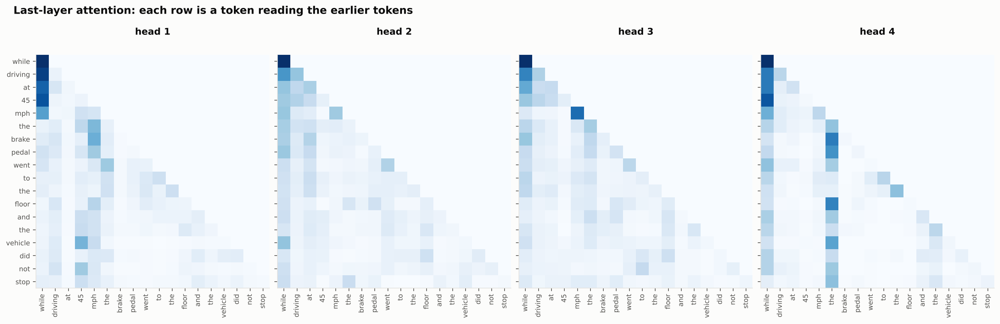

Different heads in the last layer learn different jobs. Early tokens in every head attend to
the first token (a common "attention sink"). Head 4 keeps reading the *the* that opens
*"the brake pedal"* from later words (*brake*, *pedal*, *floor*, *vehicle*, *stop*): it
tracks the subject of the sentence. Head 1 links the end of the clause (*vehicle*, *not*) back
to the speed, *45*.

### CPU inference

| Variant | Model file | Peak RAM | Time to first token | Decode speed | 64-token latency (p50) | Test perplexity |
|---|---:|---:|---:|---:|---:|---:|
| PyTorch FP32, no KV cache | 55.5 MB | 676 MB | 15.9 ms | 53 tok/s | 1188 ms | 15.99 |
| PyTorch FP32 + KV cache | 55.5 MB | 665 MB | 15.5 ms | 180 tok/s | 359 ms | 15.99 |
| PyTorch INT8 (dynamic) + KV cache | 26.8 MB | 674 MB | 5.8 ms | 246 tok/s | 259 ms | 16.20 |
| ONNX Runtime FP32 + KV cache | 68.2 MB | 278 MB | 5.8 ms | 237 tok/s | 266 ms | 15.99 |
| **ONNX Runtime INT8 + KV cache** | **17.3 MB** | **220 MB** | **3.7 ms** | **606 tok/s** | **105 ms** | **16.07** |

30 prompts from the test split, 16-token prompt, 64 generated tokens (greedy), 2 threads;
perplexity on 200 random 256-token test windows. Each variant runs in its own process.

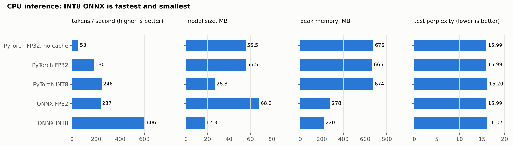

- **KV cache: 3.4× faster decoding** (53 → 180 tokens/s) with identical output; it is tested
  to give the same logits as a full forward pass.
- **ONNX Runtime: 1.3× faster than PyTorch** with the same cache and **2.4× less memory**
  (278 vs 665 MB), because the serving process never imports PyTorch.
- **INT8 dynamic quantization: another 2.6× faster and 3.9× smaller** (17.3 MB) for a
  **0.5% perplexity increase** (15.99 → 16.07). PyTorch's own dynamic INT8 is slower (246
  tokens/s) and loses more quality (16.20).
- End to end: **11.3× faster decoding** than the PyTorch baseline (64 tokens in 105 ms instead
  of 1,188 ms) with **3.1× less memory**.
- The FP32 ONNX file is larger than the PyTorch weights because the export stores the tied
  embedding and output matrices separately.

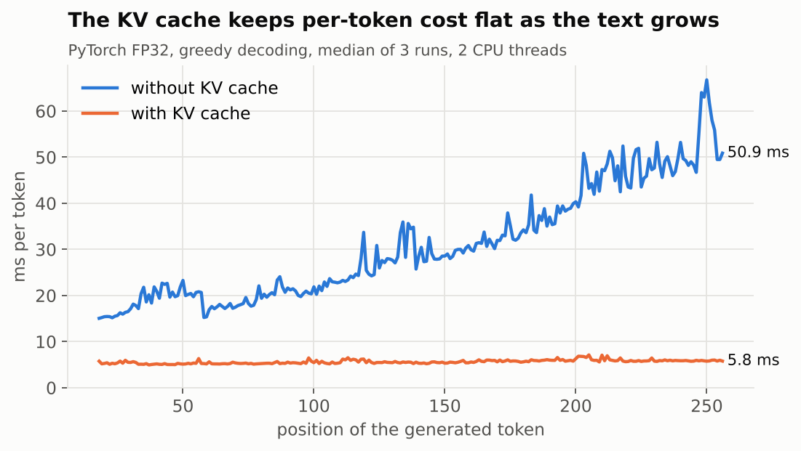

Without a cache, generating token *t* re-runs the model over all *t* tokens, so each step gets
slower: from ~15 ms per token early on to ~51 ms by position 256. With the cache, each step
processes only the new token: a flat ~5–6 ms, about 9× faster at full context.

### Serving under load (local API, 2 vCPUs)

| Concurrent users | Requests | Failures | p50 | p95 | Throughput |
|---:|---:|---:|---:|---:|---:|
| 1 | 91 | 0 | 120 ms | 170 ms | 2.3 req/s |
| 5 | 402 | 0 | 140 ms | 310 ms | 10.1 req/s |
| 10 | 467 | 0 | 500 ms | 730 ms | 12.0 req/s |
| 20 | 524 | 0 | 1200 ms | 1500 ms | 13.1 req/s |

Locust, short prompts, up to 64 generated tokens per request, 40 s per level; the API and the
load generator share the same 2-vCPU machine.

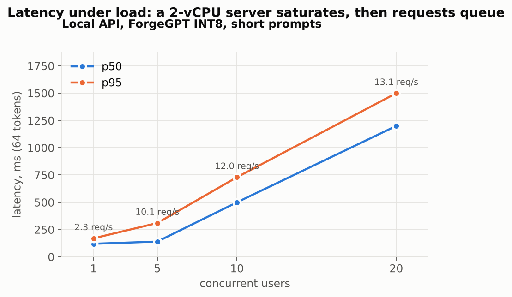

A single 2-vCPU server tops out at about **13 requests/s**. Past ~5 concurrent users,
throughput barely rises and requests queue instead: from 5 to 20 users the p50 goes from 140 ms
to 1.2 s. Scaling further means more CPU per server or more servers, which is what the
Lambda-ready path provides (one request per execution environment, scaled out).

### Cost per 1,000 requests (projected)

| Option | Basis | Cost per 1,000 requests |
|---|---|---:|
| Lambda 2 GB, ForgeGPT INT8 (projected) | local p50 latency 105 ms for 64 tokens | $0.0037 |
| EC2 m7i-flex.large, ForgeGPT INT8 at full load (projected) | local max 13.1 req/s at 20 users | $0.0020 |

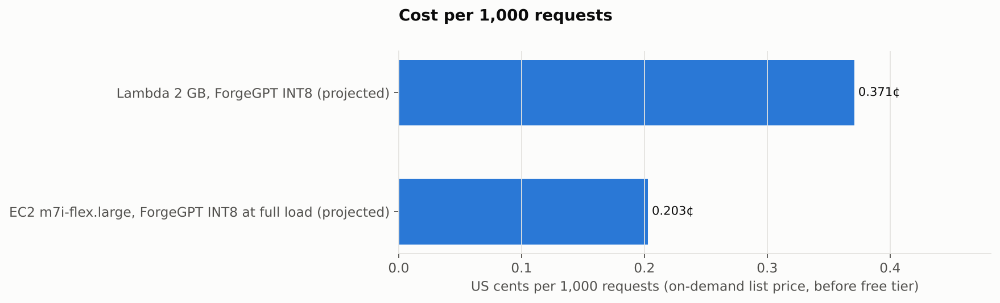

Lambda's cost per request is fixed, while an always-on EC2 instance costs ~$70/month whether
busy or idle. With these numbers **Lambda is cheaper below about 7 requests/s sustained (~0.6M
requests/day)**; above that, a busy instance wins. Both rows are projections from local
measurements at us-east-1 list prices (Lambda $0.20 per 1M requests + $0.0000166667 per GB-s;
m7i-flex.large $0.0958/h). `scripts/cost_model.py` adds measured rows once the stack is deployed.

## Web GUI

`uvicorn serving.app.main:app` serves a playground over the same ONNX Runtime code path the
Lambda handler uses: start a complaint, adjust temperature / top-k / top-p, watch tokens stream
in with time-to-first-token and tokens/s, and switch on **Show tokens** to see exactly how the
BPE tokenizer split the prompt and the output.

| Token view (dark mode) | Model card |
|---|---|
| 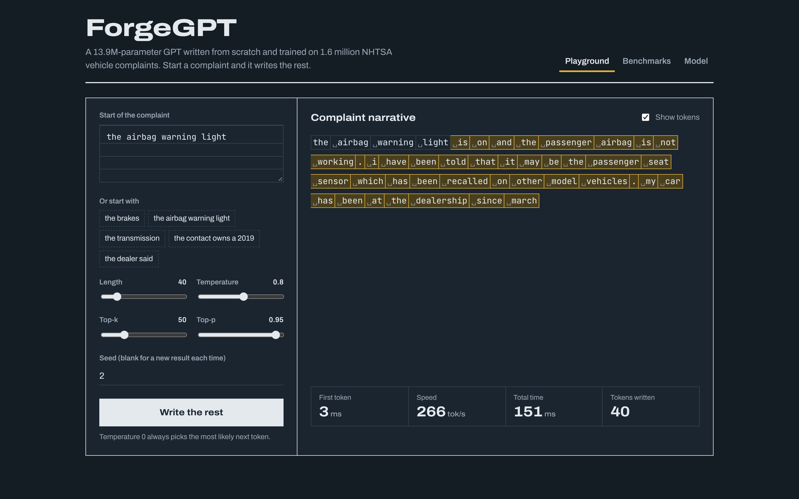 | 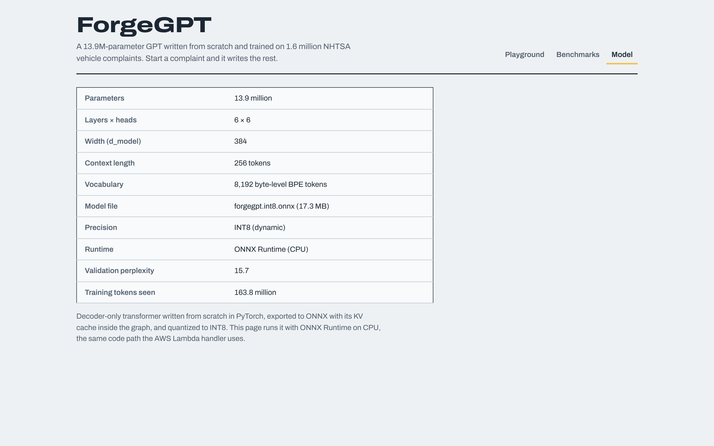 |

## Reproduce

```bash
python -m venv .venv && source .venv/bin/activate      # Windows: .venv\Scripts\activate
pip install -e ".[dev,train,serve,bench]"

# data -> tokenizer -> token files  (~10 min)
python scripts/download_nhtsa.py
python scripts/prepare_data.py
python scripts/train_tokenizer.py
python scripts/encode_data.py

# train: full model on a free Kaggle T4 with notebooks/kaggle_train.ipynb (~45 min + ablations)
#   or a small CPU-only model:  python -m forgegpt.train --config configs/cpu_demo.json

# optimize, benchmark, chart
python -m forgegpt.onnx_export --ckpt runs/kaggle_t4/ckpt_best.pt --out-dir artifacts/onnx
python scripts/benchmark_inference.py --ckpt runs/kaggle_t4/ckpt_best.pt
uvicorn serving.app.main:app --port 8000 &                # GUI at http://localhost:8000
python scripts/run_load_test.py --host http://localhost:8000
python scripts/cost_model.py
python scripts/make_charts.py

pytest                                                   # 55 tests
```

Deploying to AWS (Free plan): [docs/DEPLOY.md](docs/DEPLOY.md).

## Engineering decisions

- **Attention written by hand, checked against PyTorch.** The tests compare it with
  `F.scaled_dot_product_attention`, prove the causal mask (changing future tokens never
  changes earlier outputs), overfit a single batch, and check that KV-cached decoding gives
  the same logits as a full forward pass.
- **One ONNX graph for prefill and decode.** The KV cache is a graph input/output
  (`past` → `present`), so the same file handles the prompt (empty cache) and every
  following token. Tests check it against PyTorch for both phases.
- **fp16, not bf16, on a T4.** PyTorch reports bf16 as supported on a T4 because it can
  emulate it, which is several times slower; the trainer checks for native support
  (compute capability 8.0+) and otherwise uses fp16 with a gradient scaler.
- **A serving path without PyTorch.** Inference needs only ONNX Runtime, numpy and tokenizers:
  220 MB of RAM instead of ~670 MB, and a 56 MB Lambda zip with ~150 ms model initialization
  (measured on the Lambda Python 3.12 runtime's Linux wheels).
- **Designed for cheap deployment.** The CDK stack uses a Function URL instead of API
  Gateway, an API-key check, a `max_tokens` cap, CloudWatch Embedded Metric Format logs
  instead of metric API calls, no NAT gateway, and `cdk destroy` removes everything.

## Limitations

- The model continues text; it is not instruction-tuned and does not answer questions.
- It invents specifics (recall campaign numbers, dealer names, model names) and longer
  outputs can repeat themselves. The 14M-parameter model saw each training token about once.
- Latency, throughput and cost numbers come from a 2-vCPU machine; AWS will differ (a 2 GB
  Lambda gets about 1.2 vCPU). Cost rows are projections until the stack is deployed.
- Ablations use one seed and a short budget.
- A few free-text street addresses in older complaints are not masked (see docs/DATA.md).

## Project layout

```
src/forgegpt/      data, clean, tokenizer, model, train, generate, onnx_export, onnx_infer, serving
scripts/           data pipeline, benchmarks, load tests, cost model, charts
configs/           training configs (Kaggle T4, CPU demo)
notebooks/         Kaggle training + ablations notebook
serving/app/       FastAPI app + web GUI
serving/lambda/    Lambda handler + zip builder
serving/ec2/       llama.cpp user-data + benchmark script
infra/             AWS CDK app (+ synth tests)
benchmarks/        Locust file, results CSVs, training logs
tests/             unit and integration tests
docs/              data card, deployment guide, portfolio notes, charts
```
